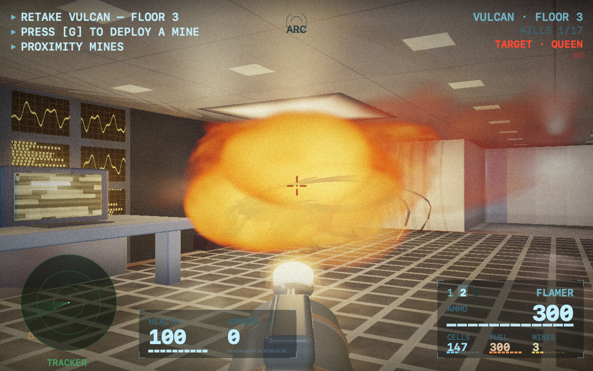
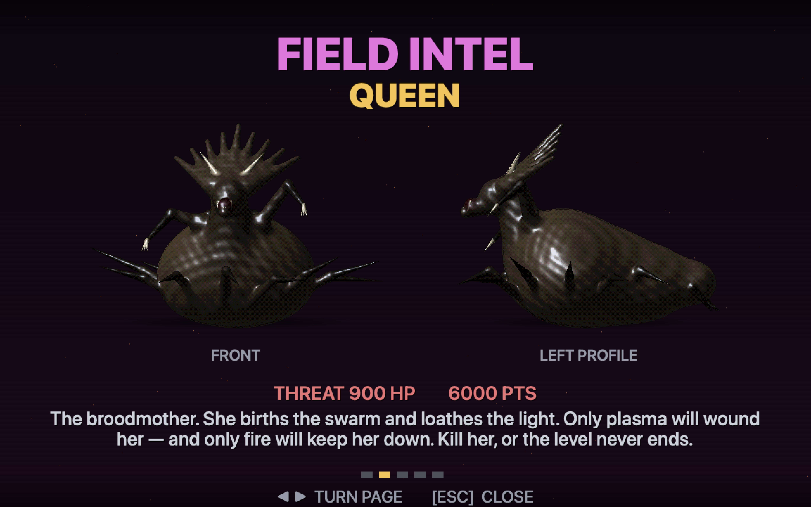
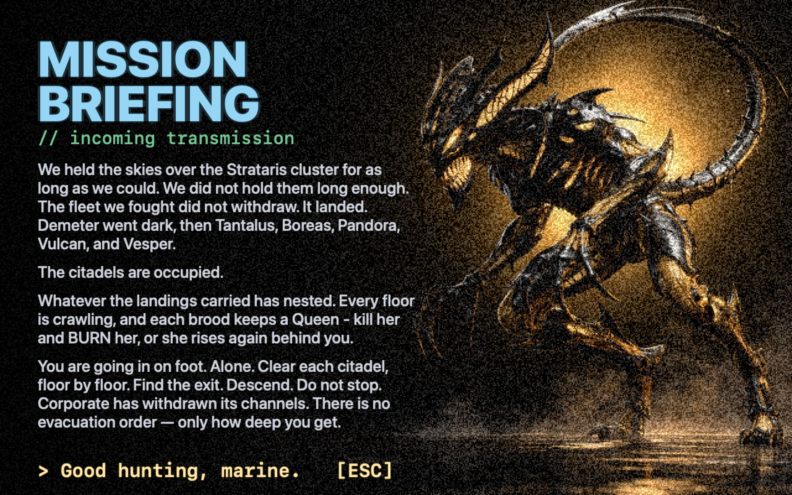
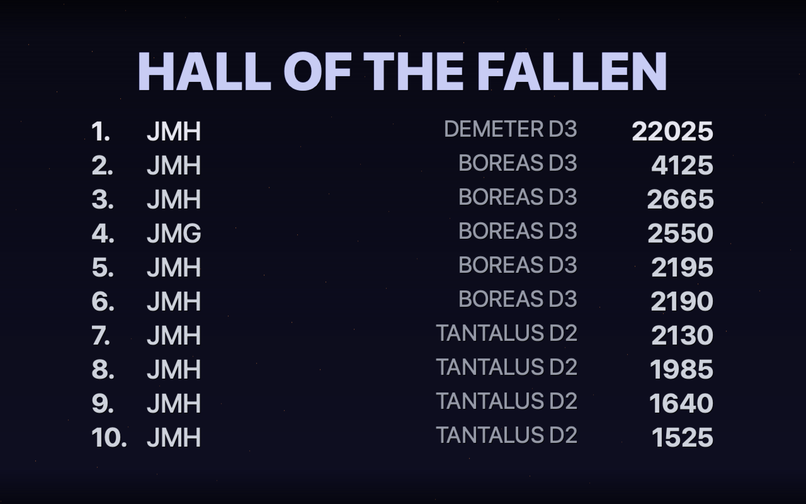

# Citadel

A first-person shooter for macOS — a *Doom* tribute set in the **Strataris**
universe. You held the skies over the colony cluster for as long as you could.
You didn't hold them long enough. The swarm landed, and the citadels of Demeter,
Tantalus, Boreas, Pandora, Vulcan and Vesper are occupied. Now you go in on foot
— clear each citadel floor by floor, put down the brood-queen that holds it, and
descend.


**The second *native* game in the Jorvik suite**, and the ground war of the
saga that opened with [Strataris](https://jorviksoftware.cc/games/strataris) —
that was the air war; this is the retake on foot.

## Rendered in code, in real time

Citadel's world is drawn in real time by a **Metal rasteriser** whose every
surface is generated in code — **no sprites, no level files, and not one texture
in the world itself.** The iron-and-steel architecture, the wall-baked pipework and
steelwork, the fuel drums and recharge panels, and the pickups are all built as
geometry at level load and shaded procedurally, HDR-lit and colour-graded on the
GPU; the fire is a puff-cloud of advected impostors. The HUD and front-end screens are drawn into a software 2-D
canvas and composited on top, then upscaled aspect-correct and letterboxed.

Four deliberate exceptions earn their place, and they are the only asset files in
the bundle:

- **The bodies.** The biomechanical aliens — the **DRONE** and the **QUEEN** — ship
  as **3-D meshes with baked base-colour maps**: organic, ridged anatomy reads
  better sculpted than generated. They are drawn over shared depth with per-pixel
  lighting, so they take fire, burn and dissolve like everything else.
- **Three hero plates.** Cinematic images back the front-end screens — the title
  among them.
- **Five imported models — geometry only.** The dormitory bunk and the four plant
  machines are downloaded meshes, decimated to the house budget. They bring **no
  materials or textures** into the game: every surface on them is re-materialled in
  code, so the shapes are borrowed and the surfaces are ours.
- **Audio.** Citadel's atmosphere leans too hard on sound to synthesise
  convincingly, so it ships a small, curated set of **CC0 / CC-BY** samples —
  weapon fire, the aliens' voices, and a reactive ambient bed that thickens as the
  swarm closes in — all credited in [CREDITS.md](CREDITS.md). (A from-scratch
  synthesiser remains in the binary as a fallback for any missing sample.)

Levels are **procedurally generated** and **verified solvable** with a keyed
flood-fill, so every floor is beatable: rooms and corridors, doors and
coloured-key locks, hidden secrets, hazard-walled fuel stores, and an exit you
have to earn.

## The game

You carry a **plasma rifle** and a **flamethrower** at all times, and find a
**rocket launcher** in the field. Ammo is finite — energy cells, pressurised
fuel and proximity mines — so every floor is a resource problem as much as a
fight.

- **The brood.** Two castes hunt you:
  - **DRONE** — a slick green-black melee pack-hunter. Slow, but it thinks: it
    comes in numbers, flanks, and kills up close.
  - **QUEEN** — the rooted brood-mother that holds each floor. She births fresh
    drones, she loathes the light, and she gates the exit. **Only plasma wounds
    her — and only fire keeps her down:** put her down with the plasma rifle,
    then **burn the corpse with the flamethrower**, or she revives and the floor
    never ends.
- **Descend.** Each of the six planets is a citadel of **eight floors**; clear a
  floor (kill and burn its Queen), then call the **freight elevator** — the
  leaves part, you step into the car, and it rides you down to the next.
  Clear the eighth and you **teleport** to the next planet — a fresh citadel that
  runs bright at the surface and dead-dark in the depths, the **lowest floors
  flooded** so you wade. **Forty-eight floors across six citadels to retake**, and
  difficulty scales with how far down you are.
- **Tools of the trade.** Shoot a **fuel drum** to rupture it into a bomb, or
  stand by one to refill the flamethrower. Plug into a wall-mounted **recharge
  socket** to top up plasma cells — the sockets slowly refill their own reserve,
  so you're never permanently starved. Drop a **proximity mine** for the swarm
  to wander onto.
- **The rooms act on you.** A **sick bay** is guaranteed to hold a med-kit, and
  standing in one slowly closes wounds — **10 points every 30 seconds** you stay.
  A room the **nukage** has reached does the reverse at the same rate, pool or no
  pool: the air in there is the hazard. Both timers reset the moment you leave, and
  neither is announced — the only tell is your own health moving.
- **The visor HUD.** No status bar — the 3-D view fills the screen, and every
  readout is projected onto the helmet visor: an *Aliens*-style **motion
  tracker** with the **objective caret** on its rim (it points to the living
  Queen, then swings to the exit once she's ash), vitals and weapon pods, and
  always-on **cells / fuel / mines** telemetry, so the survival maths is legible
  at a glance.
- **The front end.** A boot-up terminal title screen, a mission **briefing**, a
  five-page **FIELD INTEL** dossier (the brood in front + profile, the arsenal,
  the field supply, and what hurts you — and how badly), and a persistent
  **Hall of the Fallen** high-score table — name, score, depth and colony,
  across sessions.

## Screenshots



*The flamethrower opens up in an occupied ARC control room.*

| | |
|---|---|
|  |  |
| The plasma rifle and the visor HUD. | FIELD INTEL: the Queen, front and profile. |
|  |  |
| The occupation, in brief. | The Hall of the Fallen. |

## Run it

**Requires an Apple silicon Mac** (M1 or later), macOS 14 or newer. Citadel is the one Jorvik app
that isn't a universal binary, and that is deliberate: it is a real-time Metal renderer tuned to a
16.7 ms frame budget, every measurement behind that tuning was taken on Apple silicon, and an
Intel slice would have shipped without ever running on the hardware it claimed to support.

```sh
gmake build                 # arm64 .app via the shared jorvik-release pipeline
open .build/Citadel.app     # descend
```

### Controls

| | |
|---|---|
| **W A S D** | move / strafe |
| **← / →** · **Mouse** | turn / look |
| **Shift** | run (hold) |
| **Space** | fire |
| **E** | use / open door / hit switch / recover a nearby mine |
| **G** | deploy a proximity mine |
| **1 2 3** · **[ ]** | select / cycle weapon |
| **Tab** | automap |
| **P** · **M** | pause · mute |
| **B** / **I** | briefing / field intel (from the title) |
| **K** / **C** | keyboard / controller setup |
| **⌘S** / **⌘O** | save game · load game (ten named slots, from the menu) |
| **⌘,** | settings (volumes, sensitivity, reset scores) |
| **Esc** · **⌘Q** | back · quit |

Every gameplay key is **reconfigurable** from the Keyboard sheet (**K**); the
bindings above are the defaults. A connected controller (Xbox / DualShock / any
Extended Gamepad) is detected automatically — left stick moves, right stick
turns, triggers and bumpers fire and switch weapons, and the **d-pad left/right
fine-aligns the crosshair** — a genuine precision yaw at **8°/s**, which crosses the
plasma assist cone in about a second and ignores the turn-speed slider, because
delicacy is not the same preference as how fast you spin (up/down still nudge
forward/back) — and is **rebindable** from the controller sheet (**C**).
Keyboard always works alongside.

### Saving

Save whenever you like (**⌘S**), into any of **ten named slots**. A save records
the **checkpoint** — the state you *arrived on the current floor with* — and
loading rides the lift back down to that floor, so you always resume on a clean
floor start rather than half way through a fought room.

That is why a save is a few hundred bytes: the floor is **regenerated from the
run's seed**, so nothing about the map, the swarm or the mess you made of them is
written down. Saves survive death, and finishing the game doesn't clear them.

### Hidden feature flags

Most are off by default; opt in per machine with `defaults write` (read live, so a
change lands on the next frame — no relaunch):

```sh
defaults write cc.jorviksoftware.Citadel Godmode       -bool  true   # no damage
defaults write cc.jorviksoftware.Citadel FastMonsters  -bool  true   # nightmare speed
defaults write cc.jorviksoftware.Citadel RevealMap     -bool  true   # automap fully revealed
defaults write cc.jorviksoftware.Citadel ScreenshotKey -bool  true   # F saves a 1920×1080 PNG to the Desktop
defaults write cc.jorviksoftware.Citadel FixedSeed     -int   1234   # pin the level seed for testing
defaults write cc.jorviksoftware.Citadel StartLevel    -int   9      # warp new runs to a floor (1-indexed; testing)
defaults write cc.jorviksoftware.Citadel OverheadLight -float 1.0    # ceiling-lamp brightness (default 0.5 — the tuned, moody look)
defaults write cc.jorviksoftware.Citadel Headlamp      -bool  false  # strip the helmet lamp (default on — you will not see much)
defaults write cc.jorviksoftware.Citadel Aftermath     -bool  false  # strip the battle-damage dressing (default on)
defaults write cc.jorviksoftware.Citadel ScatteredPapers -bool false # strip the spilled-records decals (default on)
```

### Headless harnesses

```sh
# generator + solvability, the update loop (movement, AI, combat, scoring),
# a GPU frame + HUD draw, and high-score persistence — exits non-zero on failure:
CITADEL_SMOKE=1 ./.build/Citadel.app/Contents/MacOS/Citadel

# render the documentation screenshots into docs/screenshots:
CITADEL_SHOTS=docs/screenshots ./.build/Citadel.app/Contents/MacOS/Citadel

# the workhorse: ~65 frames covering every environment feature the game has —
# corridors, lamp pools, every room type, the plant floors, creatures at walls:
CITADEL_RASTERSHOT=/tmp/shots ./.build/Citadel.app/Contents/MacOS/Citadel

# …and the visual regression gate over those frames (a CHANGE DETECTOR, not a
# pass/fail: it reports what moved and by how much, against a committed baseline):
tools/shotcheck.py                # compare
tools/shotcheck.py --update       # accept the current renders

# …and the same idea for the DOCS: every shipped asset accounted for in CREDITS,
# every source file in ARCHITECTURE's map, no document pointing at a deleted file,
# every feature flag either documented or recorded as deliberately not:
tools/doccheck.py
```

Every harness is **hard-muted by construction** — `main.swift` forces
`CITADEL_MUTE` the moment any `CITADEL_*` variable is present, before an audio
engine can exist, so a headless run is physically incapable of making a sound.

## Architecture

A real-time Metal rasteriser draws the world — the iron-and-steel architecture
and the objects (drums, sockets, mines, pickups) built as geometry at level load
and shaded procedurally, HDR-lit and graded on the GPU — with the alien bestiary
drawn as 3-D meshes over shared depth, and the HUD and front-end screens
composited over it in a software 2-D canvas, blit-upscaled nearest-neighbour.
(An SDF raymarcher drew the world until 2026-07; the rasteriser replaced it and
the kernel was deleted.) See **[ARCHITECTURE.md](ARCHITECTURE.md)** for the rendering
pipeline and a per-file source map.

## Support

If you enjoy Citadel, you can [**buy me a coffee**](https://jorviksoftware.cc/donate) ☕ — it keeps the Jorvik lights on.

## License

Code released into the public domain under [The Unlicense](LICENSE) — do whatever
you like with it. The bundled audio is **CC0 / CC-BY**, with sources and the
required attributions listed in [CREDITS.md](CREDITS.md) — note the bundled crowd
recordings are **CC-BY 4.0** (Gregor Quendel), so that attribution must travel with
any redistribution.

---

*A Jorvik Software game.*
