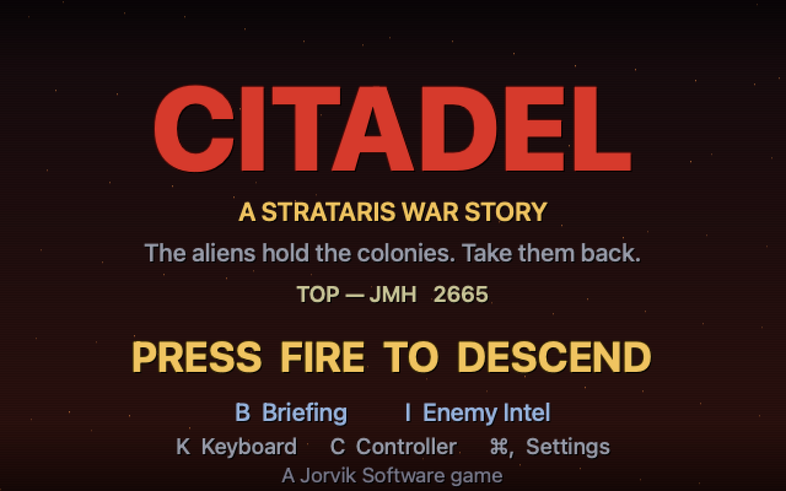
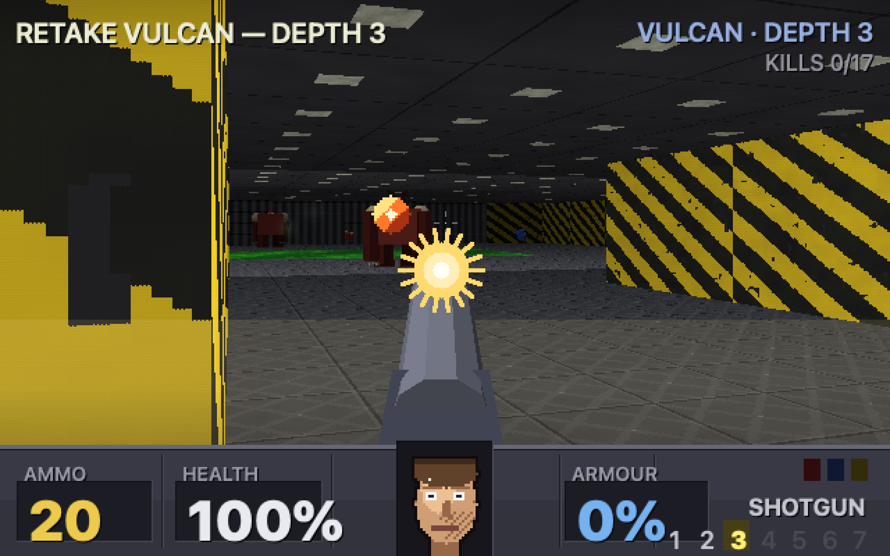
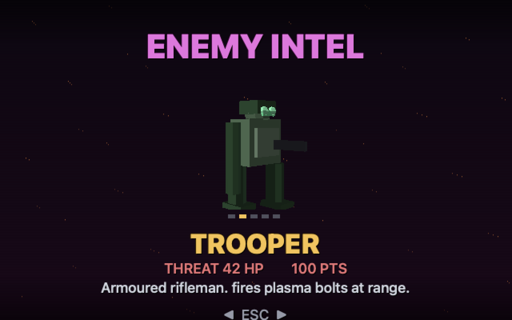
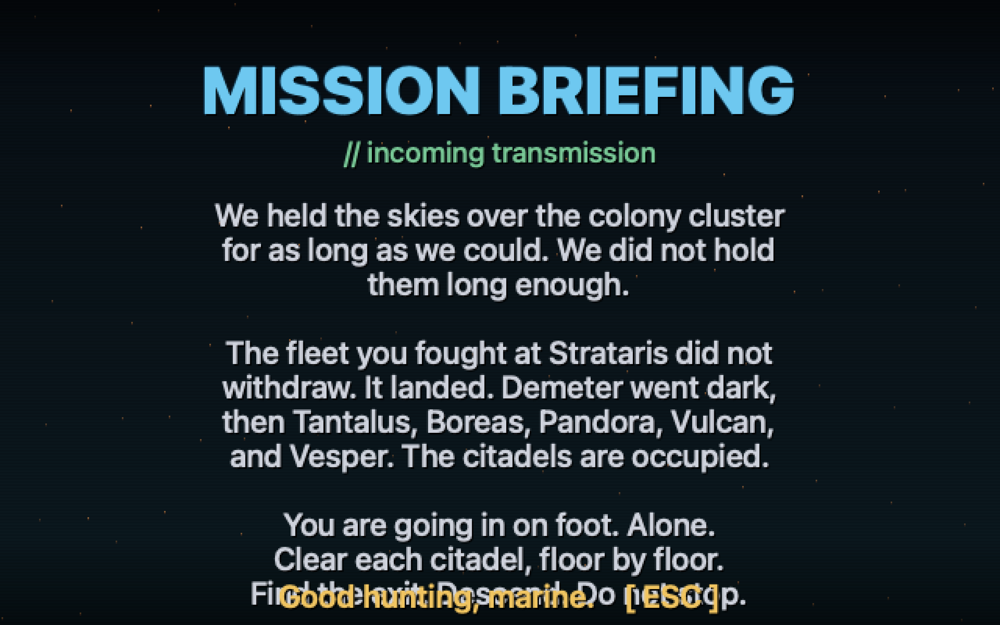
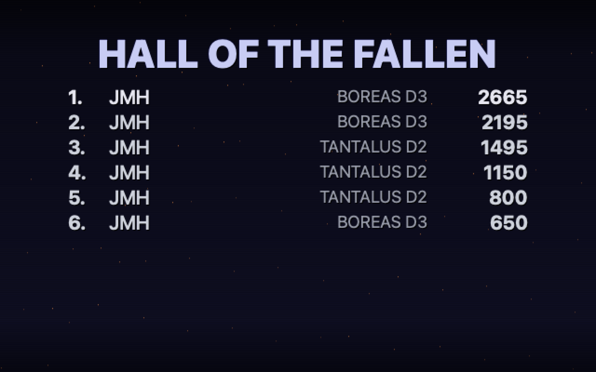

# Citadel

A first-person retro shooter for macOS — a *Doom* tribute set in the
**Strataris** universe. You held the skies over the colony cluster for as long
as you could. You didn't hold them long enough. The aliens landed, and the
citadels of Demeter, Tantalus, Boreas, Pandora, Vulcan and Vesper are occupied.
Now you go in on foot — clear each citadel floor by floor, find the exit,
descend, and chase a high score as deep as you can get.



**The second *native* game in the Jorvik suite**, and a direct sequel to
[Strataris](https://jorviksoftware.cc). Strataris was the air war; Citadel is
the ground retake.

## The whole game is a few hundred KB — and there are zero asset files

Every pixel and every sound in Citadel is **generated in code**. There are no
textures, no sprites, no audio files, no fonts, no level files to ship:

- **Levels** — a procedural generator lays out rooms, corridors, doors, locked
  doors with coloured keys, hazard pools, hidden secrets and an exit switch.
  Solvability is *verified* with a keyed flood-fill, so every level is beatable.
- **Walls, floors & ceilings** — tileable fractal-noise textures (tech panels,
  brick, marble, flesh, nukage, hazard stripes), shaded by distance and sector
  light.
- **Enemies, items & weapons** — flat pixel-art sprites built from maths: the
  occupying aliens (Grunt, Trooper, Brute, Floater and the Overlord), pickups,
  projectiles, the seven first-person weapon viewmodels, and the reactive marine
  face on the HUD.
- **Music & SFX** — a from-scratch synthesiser (square / saw / triangle / sine /
  noise voices with envelopes, overdrive and a limiter); a driving title theme,
  in-citadel ambience, and the whole sound effects set.

It renders at **320×200 — Doom's exact native resolution** — into a software
framebuffer that's upscaled nearest-neighbour, aspect-correct and letterboxed,
for the period-correct chunky pixels. The game binary is about **0.8 MB per
architecture**; the shipped `.app` is larger only because it embeds the
[Sparkle](https://sparkle-project.org) auto-updater (~3 MB).

## The game

- **Move and shoot.** Strafe, run, turn (keyboard, mouse-look or controller),
  open doors and hit switches. Seven weapons — fists, pistol, shotgun, chaingun,
  rocket launcher, plasma rifle and a screen-clearing energy cannon — a mix of
  instant-hit and projectile, each with its own ammo, spread and rate of fire.
- **Know the enemy** (points each):
  - **Grunt** — 50 — clawing swarm.
  - **Trooper** — 100 — fires plasma bolts at range.
  - **Brute** — 250 — soaks damage, hurls fire.
  - **Floater** — 175 — airborne, ignores hazard floors.
  - **Overlord** — 2500 — the citadel commander; appears in the deeper floors.
- **Find the way down.** Locked doors need the matching coloured keycard; some
  walls hide secrets. Reach the exit switch to descend to the next citadel —
  your weapons and ammo come with you. Your **depth** is the mark of progress.
- **Doom-style HUD.** A bottom status bar with ammo, health, armour, held keys,
  the arsenal, and the iconic marine face that reacts to damage and the
  direction you're turning.
- **Mission briefing & enemy intel** from the title screen, and a persistent
  **high-score table** — name, score, depth and colony, across sessions.

## Screenshots

| | |
|---|---|
|  |  |
| Brutes closing in over a nukage pool on Vulcan. | The enemy intel codex. |
|  |  |
| The occupation, in brief. | The Hall of the Fallen. |

## Run it

```sh
gmake build                 # universal .app via the shared jorvik-release pipeline
open .build/Citadel.app     # descend
```

### Controls

| | |
|---|---|
| **W A S D** | move / strafe |
| **← / →** | turn (or mouse-look) |
| **Shift** | run (hold) |
| **Space** | fire |
| **E** | use / open door / hit switch |
| **1–7** · **[ ]** | select / cycle weapon |
| **Mouse** | turn · click to fire |
| **P** | pause |
| **M** | mute |
| **B** / **I** | briefing / enemy intel (from the title) |
| **Esc** | back (close briefing/intel · abandon run from pause) |
| **K** / **C** | keyboard / controller setup |
| **⌘,** | settings (volumes, sensitivity, reset scores) |
| **⌘Q** | quit |

Every gameplay key is **reconfigurable** from the Keyboard sheet (**K**); the
bindings above are the defaults. A connected game controller (Xbox / DualShock /
any Extended Gamepad) is detected automatically — left stick moves, right stick
turns, and the actions are **rebindable** from the controller sheet (**C**).
Keyboard always works alongside.

### Hidden feature flags

Off by default; opt in per machine with `defaults write` (read live):

```sh
defaults write cc.jorviksoftware.Citadel Godmode      -bool true   # no damage
defaults write cc.jorviksoftware.Citadel AllWeapons   -bool true   # full arsenal at spawn
defaults write cc.jorviksoftware.Citadel NoClip       -bool true   # walk through walls
defaults write cc.jorviksoftware.Citadel FastMonsters -bool true   # nightmare speed
defaults write cc.jorviksoftware.Citadel ScreenshotKey -bool true  # F saves a 4× PNG to the Desktop
defaults write cc.jorviksoftware.Citadel FixedSeed    -int 1234    # pin the level seed for testing
```

### Headless smoke test

Exercises the procedural generator + solvability, the game update loop
(movement, AI, combat, scoring), the CPU raycaster + HUD draws, and high-score
persistence — with a best-effort GPU device check that skips where there's no
Metal device:

```sh
CITADEL_SMOKE=1 ./.build/Citadel.app/Contents/MacOS/Citadel
```

## Architecture

A textured raycaster (walls + per-row floor/ceiling casting + billboarded,
depth-sorted sprites) drawing into a 320×200 software framebuffer, composited
with a hand-built HUD and blit-upscaled nearest-neighbour. See
**[ARCHITECTURE.md](ARCHITECTURE.md)** for the rendering pipeline and a per-file
source map.

## Support

If you enjoy Citadel, you can [**buy me a coffee**](https://jorviksoftware.cc/donate) ☕ — it keeps the Jorvik lights on.

## License

Released into the public domain under [The Unlicense](LICENSE) — do whatever you
like with it.

---

*A Jorvik Software game.*
